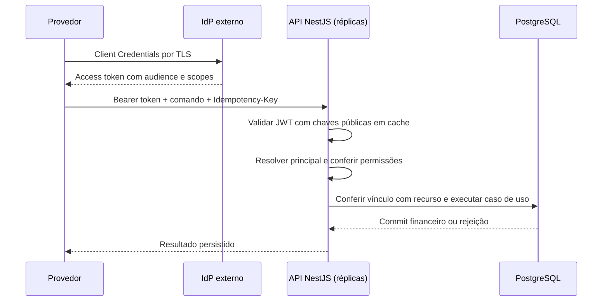

# Autenticação e autorização propostas

Estado: desenho de solução em 26/10/2026; integração OIDC/OAuth e controles abaixo ainda não implementados. A entrega atual usa ProviderIdentityPort, ProviderGuard e LocalDevelopmentIdentity no-op. A API financeira exige modo local explícito e recusa esse modo em NODE_ENV=production. Isso atende à alternativa de documentação/extensão da seção 2 do [enunciado](CHALLENGE.md), sem estabelecer segurança para exposição pública.

## Decisão

Usar um IdP externo compatível com OAuth 2.0/OIDC. Keycloak é a referência para demonstração reproduzível com Compose; um serviço gerenciado compatível pode reduzir a operação do IdP em produção. A escolha de fornecedor depende de disponibilidade exigida, equipe, custo e integração existente, sem vincular o domínio financeiro a um produto.

Neste serviço, as chamadas de apostas são principalmente entre sistemas. Quantidade de jogadores e quantidade de identidades de integração são grandezas diferentes: um provedor autenticado pode enviar operações de muitos jogadores. A identidade do jogador no payload não autentica uma pessoa nem autoriza seu acesso à wallet.

Provedores usam OAuth 2.0 Client Credentials, com cliente/service account exclusivo por integração e ambiente. Proposta inicial: access tokens JWT de cinco minutos, reutilizados até perto da expiração, com renovação antecipada e jitter. O valor é uma decisão de operação a validar, não exigência do protocolo. Para M2M, obter novo token com credencial do cliente; não depender de refresh token de usuário. Preferir autenticação de cliente por chave assimétrica (private_key_jwt) ou mTLS quando viável; secrets rotacionáveis são uma opção para a demonstração local, sempre fora do repositório e em secret manager na produção.

Operadores humanos usam OIDC Authorization Code com PKCE e MFA no IdP. Um eventual painel pode usar BFF com sessão em cookie Secure/HttpOnly/SameSite e proteção CSRF; o BFF mantém tokens fora do JavaScript do navegador. Não haverá endpoint próprio para receber senha, password grant ou tabela própria de hashes de senha. Interface de jogador é uma extensão futura: precisa de identidade subject/player vinculada por fonte confiável e permissões específicas.

## Fluxo entre serviços

A API é resource server. Validar assinatura com algoritmo permitido explicitamente, issuer exato, audience destinada a backend-ballance, expiração e nbf quando presente, tolerância de relógio limitada e claims obrigatórias. Usar biblioteca mantida; não implementar criptografia/JWT manualmente. Aceitar access token, nunca ID token como credencial da API. O perfil/tipo de token deve ser acordado com o IdP; não presumir que qualquer JWT emitido pelo realm é válido para esta API.

Issuer/JWKS são configurados pelo operador. Não buscar URLs recebidas em claims ou headers do token. Mapear identidade verificada (issuer + client_id/sub, conforme contrato do emissor) para providerId autorizado, ou usar claim provider_id controlada administrativamente no IdP. O cliente não pode editar seu vínculo. Divergência entre providerId verificado e corpo/rota resulta em 403, inclusive em replay. Headers de identidade arbitrários não serão confiáveis.

## Autorização dos recursos

Token válido prova identidade; scopes e vínculos com o recurso determinam acesso. Proposta:

| Operação | Identidade/permissão proposta | Restrição |
|---|---|---|
| Submeter aposta/reversão | Provedor, wagering:submit | providerId verificado e grant da wallet/player |
| Consultar transação | Provedor, wagering:read | Transação do mesmo provider e recurso autorizado |
| Consultar saldo | Provedor, wallets:read | Grant explícito da wallet |
| Criar wallet/definir saldo inicial | Serviço de provisionamento/operador autorizado, wallets:create | Não conceder a provedores de jogos por padrão |
| Ledger completo | Operação/auditoria, ledger:read | Evitar expor operações de outros provedores |
| Reconciliação | Operação/auditoria, wallets:reconcile | Escopo de recursos permitido |
| Health | Aberto conforme enunciado | Resposta sem detalhes sensíveis |
| Métricas | Coletor/rede interna | Não publicar livremente na Internet |

A wallet atual pertence a player/currency, não a um provider. Portanto o simples confronto de providerId não resolve autorização de wallet. Propor cadastro administrativo provider_wallet_access (ou vínculo equivalente ao tenant/operador), sem senhas, para explicitar quais integrações podem atuar sobre quais recursos. Não inferir permissão a partir do UUID fornecido nem dar acesso a todas as wallets porque o provedor possui token. A regra comercial de compartilhamento deve ser definida antes de implementar esse vínculo.

O endpoint que consulta por transactionId também precisa checar o provider do registro carregado, mesmo sem providerId na URL. Consultas de recursos fora do escopo devem adotar política consistente de 403 ou 404 para evitar enumeração. Falta/token inválido resulta em 401; token válido com permissão insuficiente, 403. Autorização antecede replay e processamento financeiro. Quando revogação de grant precisar de efeito rigoroso sobre operações concorrentes, o vínculo deve ser revalidado dentro da unidade transacional com estratégia de lock definida; cache de autorização não pode prometer revogação imediata.

Evoluir ProviderIdentityPort para um principal verificado contendo subject, clientId, providerId opcional, tipo de principal e permissões. Separar validação do token de políticas de acesso ao recurso. Operadores não devem receber providerId artificial para caber no contrato atual. Domínio permanece sem dependência de NestJS/IdP; restrições transacionais continuam nos casos de uso e no banco.

## Escala, chaves e revogação

Cada réplica verifica assinatura localmente usando JWKS em cache limitado. Renovação periódica, coalescência de refresh concorrente, timeout e limitação de buscas por kid desconhecido evitam transformar requisições inválidas em carga irrestrita no IdP. Rotação deve manter sobreposição de chaves suficiente para tokens emitidos, TTL de cache e tolerância de relógio. Não usar introspecção remota em toda aposta como padrão desta proposta.

A consequência é explícita: bloquear uma conta no IdP não invalida instantaneamente JWT já emitido. Tokens válidos com chave conhecida podem continuar sendo aceitos dentro da política limitada de cache e até expirar; um token cuja assinatura não possa ser verificada não será aceito. Uma exigência de bloqueio imediato pede mecanismo adicional, como revogação/versionamento distribuído ou introspecção para operações escolhidas, com custo de latência/disponibilidade definido. Não fazer fallback automático para modo local quando o IdP falhar.

Balanceador distribui requisições entre réplicas sem sessão HTTP local obrigatória. IdP tem capacidade/HA independentes, banco próprio e procedimentos de recuperação. Uma instância Keycloak em Compose demonstra integração; não demonstra HA. Em produção, selecionar topologia suportada e testar emissão de tokens, rotação, falhas e recuperação conforme SLO. Rate limits por identidade na borda devem ter coordenação entre réplicas; limites por IP antes da autenticação ajudam a conter abuso. Não registrar bearer tokens, secrets ou payloads financeiros completos.

JWT local facilita escalar autenticação, mas não prova throughput financeiro: wallet disputada continua serializada; pool/conexões PostgreSQL e custo dos triggers exigem teste de carga. Nenhuma meta de usuários simultâneos ou transações por segundo foi demonstrada.

## SQS e fronteira de confiança

Conforme enunciado, consumidores não precisam exigir JWT em cada mensagem interna. Em produção, usar IAM/workload identity e políticas mínimas por fila: ingresso envia comandos, consumidor recebe/apaga, publisher envia eventos. Usar TLS e proteção dos dados adequada ao ambiente. Credenciais sintéticas do LocalStack não serão usadas em produção.

Provedores externos entram por ingresso autenticado; somente componentes internos autorizados publicam na fila compartilhada. Permissão SendMessage numa fila compartilhada não vincula automaticamente o providerId do body ao produtor. Se acesso direto do provedor ao broker for necessário, desenhar uma fronteira adicional, como ingresso/fila exclusiva com identidade verificada; não confiar apenas no campo declarado. Token bearer não deve ser transportado para backlog/retries: pode expirar antes do processamento e aumenta exposição. Identidade normalizada/auditável do ingresso pode acompanhar o contrato por mudança versionada; a correção e as validações financeiras permanecem compartilhadas entre HTTP e SQS.

## Implementação futura e critérios de aceite

1. Definir vínculo provedor/operador/player/wallet e matriz de autorização; revisar o contrato de principal antes de habilitar acesso externo.
2. Adicionar Keycloak opcional ao Compose com versão/digest verificados na implementação, banco/credenciais próprios, realm/configuração revisáveis e usuários/clients de teste provisionados sem segredos versionados. Definir issuer estável alcançável pelos clientes e validadores, evitando conflito localhost/hostname de container.
3. Integrar verificador JWT/JWKS e políticas de recurso. Modo oidc deve recusar configuração incompleta; local continua opt-in e proibido em produção. Nenhum fallback permissivo.
4. Testar IdP real: token ausente/expirado, issuer/audience/algoritmo incorretos, ID token indevido, provider divergente, scopes insuficientes, acesso cruzado a wallets/transações, abertura/reconciliação restritas e replay autenticado.
5. Verificar rotação e sobreposição de chaves, kid desconhecido em rajada, falha do IdP, expiração do cache, múltiplas réplicas, isolamento IAM e health aberto. Medir latência/throughput antes de escolher dimensionamento.

Nenhuma integração, migration de autorização, credencial, serviço ou teste novo foi executado nesta etapa documental. Os 203 testes da entrega anterior continuam sendo a última validação de código.

## Referências

- [RFC 9700 — práticas de segurança OAuth 2.0](https://www.rfc-editor.org/rfc/rfc9700.html).
- [RFC 9068 — perfil e validação de access tokens JWT](https://www.rfc-editor.org/rfc/rfc9068.html).
- [Keycloak — endpoints OIDC, chaves públicas e introspecção](https://www.keycloak.org/securing-apps/oidc-layers).
- [Keycloak — service accounts e Client Credentials](https://www.keycloak.org/docs/latest/server_admin/index.html#_service_accounts).
- [Keycloak — disponibilidade e topologias](https://www.keycloak.org/high-availability/introduction).
