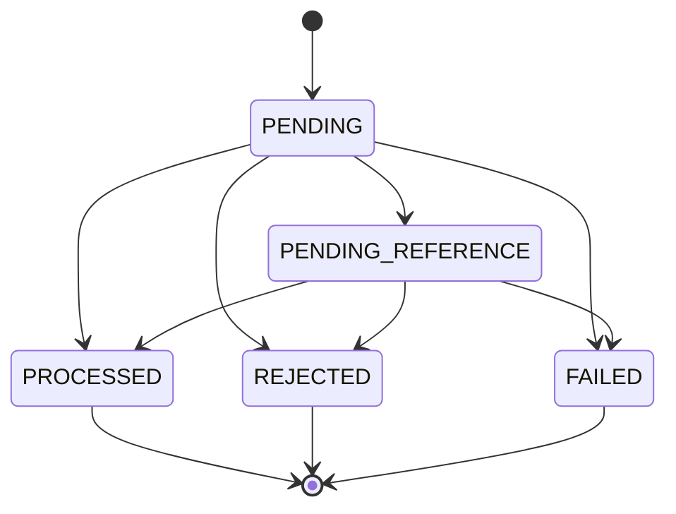

# Decisões de negócio e engenharia — solução implementada

Revisão documental em **28/10/2026**. Este documento descreve a solução implementada e as interpretações adotadas para os pontos deixados em aberto pelo [enunciado](CHALLENGE.md). Setup no [README](../README.md), desenho em [ARCHITECTURE.md](../ARCHITECTURE.md) e evidências no [registro de validação](VALIDACAO_CANDIDATA.md).

**Estado desta entrega:** inclui runner, Swagger local e painel de relatórios. A validação da pasta publicada teve **215 testes/857 assertions**, zero falhas, typecheck/build e smoke aprovados; consulte o [registro](VALIDACAO_CANDIDATA.md). Os números abaixo referem-se a edições anteriores.

O repositório completo teve validação registrada de **205 testes/819 assertions**. O pacote essencial exclui os dois controles específicos do runner de carga e teve **203 testes/799 assertions**, além de typecheck, build, smoke e stop/up aprovados. Esses números são registros anteriores; a revisão deste documento não executou novamente as suítes.

## Interpretações de negócio adotadas

A tabela distingue decisões que detalham o contrato de regras já exigidas. Nenhuma interpretação abaixo autoriza ignorar saldo não negativo, idempotência ou auditoria.

| Ponto do desafio | Solução tomada e motivo | Implementação e evidência |
| --- | --- | --- |
| LOSS sem efeito no saldo | Exigir `money.amount = "0.00"`. A perda registra o resultado; o débito ocorreu no BET. Evita atribuir outro movimento monetário à perda. | [WagerTransaction](../src/domain/wager-transaction.ts); [testes dos casos de uso](../tests/integration/financial-use-cases.test.ts), cenário `LOSS produces processed event without changing balance, ledger or version`. |
| WIN pode referenciar BET | Permitir prêmio diferente do valor da aposta; igualdade de valor é exigida para REFUND/ROLLBACK. O valor do WIN é o crédito solicitado, sem somar automaticamente a aposta original. | [Domínio](../src/domain/wager-transaction.ts); [teste](../tests/unit/wager-transaction.test.ts), `WIN can reference BET with a different payout amount`. |
| Reversão uma vez por tipo | Unicidade por `(reference_transaction_id, kind)` para reversões processadas. Um REFUND e um ROLLBACK da mesma BET podem coexistir, seguindo a regra por tipo do enunciado; não se acrescentou uma proibição global entre os dois tipos. As implicações financeiras exigem alinhamento antes de uso em produção. | [Migration inicial](../src/infrastructure/persistence/migrations/Migration202610260001FinancialSchema.ts), índice `successful_reversal_once`; [teste SQL](../tests/integration/financial-schema.test.ts), `full reversal once per type; different reversal types remain permitted by specification`. |
| Moeda única permitida | Contratos públicos aceitam somente BRL para reduzir escopo. Money continua distinguindo moedas e rejeitando operações entre moedas incompatíveis. Formato de três letras não equivale a consultar catálogo ISO-4217. | [Preparação do comando](../src/application/wager-request.ts), [Money](../src/domain/money.ts), [contratos](CONTRACTS.md). |
| Representação e capacidade monetária | Normalizar `"1.2"` para `"1.20"`; rejeitar `"1.234"`, sem arredondamento. Limite de magnitude `999999999999999999.99`. Crédito que ultrapassa o saldo suportado gera rejeição `BALANCE_LIMIT_EXCEEDED`, sem lançamento. | [Money](../src/domain/money.ts), [caso de uso](../src/application/financial-use-cases.ts), [migration da taxonomia](../src/infrastructure/persistence/migrations/Migration202610260002BalanceLimit.ts); [testes de Money](../tests/unit/money.test.ts) e casos de uso. |
| Política de espera por referência | TTL de 24h desde a aceitação; backoff exponencial com base de 1s, jitter e teto de 5min. Se a referência continua ausente/pendente na avaliação após o prazo, rejeitar com `REFERENCE_EXPIRED`. Uma referência já processável segue as regras de domínio: TTL não é cancelamento automático de toda pendência. | [Caso de uso](../src/application/financial-use-cases.ts), [scheduler](REFERENCE_SCHEDULER.md), [testes](../tests/integration/reference-scheduler.test.ts). |
| Taxonomia de rejeição | Códigos estáveis distinguem saldo de aposta, saldo para reversão, referência, limite monetário e falha permanente. Erro transitório não vira rejeição financeira fictícia. A tabela pública inclui também erros anteriores à aceitação, retornados como `code`, não necessariamente `failureCode`. | [Taxonomia e ações](CONTRACTS.md#taxonomia-inicial), [contrato HTTP](HTTP_API.md#contratos-e-erros), tipos `RejectionCode`/`FailureCode` no domínio. |
| Carteira inexistente | Recusar antes da aceitação, HTTP 404; não criar transação financeira com FK apontando para carteira inexistente. | [Casos de uso](../src/application/financial-use-cases.ts), [contratos](CONTRACTS.md), [testes HTTP](../tests/integration/financial-http.test.ts). |
| Resultado por rodada | Não impor unicidade geral de WIN/LOSS por rodada: o desafio estabelece identidades por operação e não define essa restrição adicional. Cada identidade financeira continua protegida contra repetição. | [Schema](FINANCIAL_SCHEMA.md) e [arquitetura](../ARCHITECTURE.md). |

Saldo nunca negativo, reversão integral, identidade da referência, estados terminais e replay com resultado original são **exigências preservadas**, detalhadas nas decisões seguintes. Locks, retries SQL e leases são soluções técnicas para atendê-las, não novas permissões de negócio.

## 1. Testes acompanham a implementação

**Decisão implementada:** domínio com testes unitários desde o início; infraestrutura com PostgreSQL e LocalStack reais. Evita descobrir erros de escala, aritmética ou transição somente depois de conectar os workers. Mocks não provariam locks, constraints nem redrive do broker.

**Evidência:** Money, Wallet, ledger e WagerTransaction testados; suíte de infraestrutura com rollback e DLQ reais no emulador. **Limite:** unidade/infraestrutura não substituem concorrência real. A suíte financeira também inclui três processos Bun independentes e barreira de início; mensageria inclui processos mortos em janelas controladas. Comandos no [README](../README.md#testes).

## 2. Money é um valor exato e imutável

**Decisão implementada:** decimal.js, entradas string, resultados com duas casas e limite compatível com numeric(20,2). Normalizar 1.2 para 1.20 é aceito; 1.234 é rejeitado sem arredondamento. Aritmética interna admite sinal para diferença/reversão; entrada financeira não admite negativo.

**Alternativa:** centavos em bigint também dariam precisão exata, com mapeamento explícito. Decimal foi escolhido pela proximidade com os contratos e PostgreSQL. **Custo:** cuidar da precisão configurada e impedir conversão do driver para number. Código numérico de porta/versão/timestamp não representa dinheiro.

**Implementado:** Money.rehydrate assinado; preparação pública aceita BRL. Money valida formato de moeda, sem catálogo completo ISO-4217.

## 3. Domínio separado do framework e banco

**Decisão implementada:** entidades sem decorators NestJS/MikroORM, construídas por factories. `create`/`open` validam novas operações; `rehydrate` apenas reconstrói estado confiável, sem debitar novamente ou reaplicar transições. Dates são copiadas para evitar mutação externa.

**Custo:** mapeadores explícitos e mais código entre domínio e persistência. **Benefício:** regras podem ser estudadas e testadas sem subir API ou banco. Rehydrate nunca deve receber payload público diretamente.

## 4. Movimento retorna ledger antes de mudar estado

**Decisão implementada:** Wallet.debit/credit validam o lançamento antes de atualizar balance/version/updatedAt. Se moeda, valor, saldo ou contexto forem inválidos, a wallet fica intacta. Abertura positiva exige identidade da transação OPENING e retorna crédito; abertura zero não gera lançamento. Versão começa em 1 e só cresce quando o saldo muda.

**Limite:** a entidade não persiste, não faz lock e não deduplica chamadas. O caso de uso implementado guarda wallet, transação, ledger e outbox no mesmo commit. Ledger em memória está congelado; proteção SQL append-only implementada e testada em schema isolado.

## 5. WagerTransaction encapsula transições

**Decisão implementada:** estados terminais não transitam. Factory pública rejeita OPENING; factory interna separada o permite. LOSS exige zero e não tem direção de ledger. Reversões exigem valor integral igual à referência. WIN com referência pode ter payout diferente da BET.

Reagendar PENDING_REFERENCE mantém o estado; não representa uma nova aceitação nem deve gerar outro evento de entrada. Referência ausente/pendente gera sinal para o caso de uso aguardar. Referência terminal rejeitada/falha é incompatível e leva à rejeição auditável pelo caso de uso. A entidade não executa retries nem escolhe status HTTP.

**Limite:** markProcessed valida referência e estado, mas não confirma existência de débito/ledger no banco; essa ligação é garantida pela transação SQL e pelo schema implementados. Persistência do resultado e replay concorrente agora implementados nos casos de uso.

## 6. Reversões têm regras específicas

**Implementado no domínio:** referência do mesmo provider/player/wallet/moeda/rodada; REFUND somente BET; ROLLBACK de BET é crédito e de WIN/REFUND é débito. Não permitir referência a LOSS, OPENING ou outro ROLLBACK. Reversão que debita além do saldo usa código distinto de aposta sem saldo.

**Interpretação registrada:** unicidade é por (referência, tipo), conforme enunciado: REFUND e ROLLBACK da mesma BET podem coexistir, embora tenham implicações financeiras que merecem alinhamento em produção. A constraint única parcial está implementada e testada na migration inicial. A entidade isolada não sabe se outra transação já reverteu a referência.

## 7. Lock por wallet e schema como garantia final

**Implementado:** pessimistic lock de linha no PostgreSQL, sem lock global. Após o lock, validar saldo e atualizar wallet/ledger/transação/inbox/outbox em uma transação. Wallets diferentes podem avançar em paralelo; uma wallet muito disputada serializa e pode aumentar latência.

**Alternativas:** optimistic locking com retry ou update condicionado. São válidas, mas exigem tratamento adicional de conflito. **Evidência:** implementação e provas com três processos, 50 duplicatas e duas BET de 80 sobre saldo 100 concluídas. FIFO sozinho não protege o endpoint HTTP nem substitui constraints.

## 8. Inbox e outbox dão recuperação sem prometer publicação única

**Implementado:** inbox deduplica (consumerName, messageId), identidade financeira deduplica o comando e outbox guarda evento no commit financeiro. Ack SQS só depois de commit. Publicação ocorre depois, com lease recuperável e eventId estável.

Se o processo morrer depois de publicar e antes de marcar publishedAt, outra instância pode publicar de novo. Consumidor precisa deduplicar. Não há transação única envolvendo PostgreSQL e SQS; o compromisso é at-least-once com efeitos financeiros idempotentes.

**Já validado:** inbox/outbox atômicas, FIFO/redelivery/DLQ, workers, crash entre commit/ack e publishers concorrentes; ver MESSAGING.md.

## 9. Migrations reversíveis e testes isolados

**Implementado:** MikroORM 6.6.17 com conexão explícita e runner up/down/pending; teste up/down/up com migration de prova em schema único. Sem schema sync automático no startup da aplicação. **Custo:** DDL, índices e triggers exigem revisão e testes próprios.

**Implementado:** migration financeira real e permissões/constraints já validadas em schema isolado. Runtime restrito foi provisionado em projeto Compose isolado; public e ambiente de desenvolvimento original foram preservados. Reversibilidade de uma migration vazia de negócio não prova rollback seguro de dados históricos; produção exigiria plano e backup adequado.

## 10. Escopo de entrega

**Solução entregue:** requisitos obrigatórios e runtime local concluídos. Autenticação externa permanece somente documentada, conforme permitido pelo desafio e decidido pelo usuário. Esta edição inclui Swagger local, runner exploratório e painel de relatórios históricos/importados. Não há OpenTelemetry, dashboard operacional ao vivo ou contabilidade de partidas dobradas. O ledger entregue contém débitos/créditos por wallet. Runner e visualização são opcionais e não integram o runtime financeiro de produção. A edição essencial anterior excluía esses recursos; essa exclusão não se aplica ao conteúdo deste repositório.

**Evidência e limite:** há testes de correção entre processos e medições exploratórias locais, sem demonstração de capacidade de produção ou alta disponibilidade. O [registro de validação](VALIDACAO_CANDIDATA.md) descreve a execução desta entrega. A seção 18 consolida os experimentos e a entrega reproduzível.

## 11. Eventos como snapshots e hash como contrato estável

**Implementado:** quatro subclasses de IntegrationEvent, version=1 e snapshots JSON imutáveis. Todas usam aggregateId=walletId e recebem eventId do contexto. Não gerar um novo ID ao serializar permite republicação com identidade estável. A factory confere estado da fonte; não comprova que houve commit.

**Implementado:** normalizador de negócio compartilhado entre preparação HTTP/SQS, SHA-256 de JSON ordenado e dinheiro normalizado. Sem metadados no hash. O contrato público foi reduzido a BRL; evita aceitar códigos arbitrários enquanto o domínio Money mantém verificações multi-moeda. Não há trim silencioso nem normalização Unicode de IDs.

**Alternativas e custo:** usar canonicalização genérica como RFC 8785 traria uma especificação mais ampla. O contrato atual só contém strings/objetos e usa algoritmo restrito documentado, com vetor conhecido independente. Mudar normalização após persistir hashes exige compatibilidade explícita. Eventos copiados/congelados custam alocação, em troca de impedir que alterações posteriores na entidade mudem payloads já produzidos.

**Implementado:** chaves e envelopes persistidos no commit financeiro; adaptação HTTP/SQS implementada. Detalhes, exemplos e limites em [EVENTS_AND_HASH.md](EVENTS_AND_HASH.md).

## 12. Schema, precisão e garantias no commit

**Implementado e testado:** seis tabelas da aplicação (wallets, wager_transactions, wallet_ledger, inbox_messages, outbox_messages e reference_jobs), mais o histórico de migrations do MikroORM; numeric exato com CHECKs, mapeadores, FKs/UNIQUE e triggers de consistência adiados até o commit. Conferir saldo agregado não basta: validar também cadeia dos saldos intermediários, versão e correspondência de cada operação com seu lançamento.

**Mudança da proposta inicial:** numeric(20,2) arredondaria entradas com mais casas antes do CHECK. Numeric sem typmod com scale <= 2 e magnitude limitada rejeita escala excedente sem arredondamento. Leitura do driver normaliza somente strings válidas; números JS são rejeitados. [Motivo e referência oficial](FINANCIAL_SCHEMA.md).

**Trade-off:** agregação/janela por wallet a cada disparo custa mais conforme o ledger cresce. Foram realizadas medições exploratórias locais; nenhuma capacidade de produção foi estabelecida. Locks do schema serializam a wallet; casos de uso implementados seguem wallet antes de reservar transação. A sequência anterior foi revista antes de existir serviço financeiro.

**Permissões:** grants para papel não proprietário e triggers complementam a imutabilidade. Conta administrativa do Compose fica no provisionador; API/workers usam papel restrito provisionado no schema financial da stack isolada de entrega. Public e dados do ambiente de desenvolvimento original foram preservados.

**Limite:** schema não sabe se result_snapshot contém a resposta HTTP correta ou se o publisher publicou depois do commit. Esses comportamentos são responsabilidades dos casos de uso e workers; testes de snapshot/replay e de publicação/recuperação já os exercitam.

## 13. Unidade transacional e replay histórico

**Implementado:** OpenWallet e ProcessWagerTransaction dependem de uma porta, com adaptador MikroORM por operação. Saldo é lido sob lock, identidades são reconsultadas e a resposta terminal é persistida no commit com ledger e outbox. Replay não recalcula saldo atual e não gera novo evento. UNIQUE resolve races que escapam da consulta inicial; retry reabre a transação por inteiro.

**Decisão:** quatro tentativas no máximo para conflitos SQL recuperáveis, sem chamadas externas no callback. Rejeição de negócio vira registro/evento; falha de infraestrutura desfaz o conjunto e propaga. Atualizar somente campos mutáveis protege identidade e precisão original dos timestamps.

**Mudança de taxonomia:** BALANCE_LIMIT_EXCEEDED impede tratar crédito acima da capacidade como falha inesperada. Nova migration estende o CHECK sem editar a primeira. Rollback que invalidaria auditoria é recusado, nunca apaga dados para concluir.

**Evidências:** 50 duplicatas, duas BETs disputando saldo, lock de wallet independente e três processos Bun com barreira de início. Replay histórico foi conferido em processos novos após outros movimentos. Experimentos exploratórios de carga também foram executados posteriormente, com limites descritos na seção 18.

**Implementado nas etapas seguintes:** integração HTTP/workers, inbox na mesma sessão, publicação com lease, crash entre commit/ack e publishers concorrentes. Resume é a entrada chamada pelo scheduler automático. [Detalhes e comandos](FINANCIAL_PROCESSING.md).

## 14. HTTP fino, cursor exato e snapshot de reconciliação

**Implementado:** controllers delegam regras financeiras aos casos de uso; contratos explícitos rejeitam campos/tipos inválidos e retornam códigos distintos para conflito, rejeição, pendência e infraestrutura. Erros não expõem SQL ou texto interno. ProviderIdentityPort/guard deixam extensão para IdP; modo local é declarado e não aceito em produção.

**Cursor:** armazenar texto UTC com microssegundos no cursor, em vez de converter para Date, preserva a posição real no PostgreSQL. Base64url é formato opaco, não criptografia ou autorização. Wallet/version/formato são validados e limite máximo é 100.

**Reconciliação:** REPEATABLE READ evita comparar saldo de um commit com ledger de outro. Divergência gera resposta/log/métrica e não é corrigida silenciosamente. A métrica é por processo, independente da idempotência persistente.

**Startup:** rotas financeiras exigem ativação explícita, schema migrado e papel não proprietário/administrativo. Não criar usuários ou migrar no startup. Testes usam papel/schema temporários; runtime persistente foi validado no projeto Compose isolado, via provisionador separado.

**Evidência:** testes HTTP incluem microssegundos, concorrência com reconciliação e falha transitória simulada sem parar containers. O registro de 163 testes/589 assertions pertence à etapa histórica de implementação HTTP; os totais consolidados estão na abertura deste documento. [Guia HTTP e comandos](HTTP_API.md).

## 15. Inbox na mesma sessão e leases com token

**Implementado:** inbox opcional dentro de ProcessWagerTransaction.execute, usando a mesma FinancialSession de wallet/ledger/outbox. Separar consumerName/messageId do identificador financeiro preserva duas garantias: redelivery do envelope e replay do comando em nova mensagem.

**Hash de transporte:** inclui envelope completo, inclusive key/timestamp, sem atributos mutáveis do SQS. Mudança de key no mesmo messageId conflita na inbox, mesmo que o hash financeiro seja igual. Não usar somente hash de negócio na inbox.

**Publisher:** claim curto com SKIP LOCKED, envio fora da transação, lease renovável e confirmação por token. Publicação exatamente uma vez não foi prometida: crash após send pode duplicar; mesmo eventId permite dedup persistente downstream. Teste Standard expõe duplicata que FIFO poderia esconder.

**DLQ:** somente apagar a origem depois da confirmação do envio; falha de DLQ preserva origem. Diagnóstico em atributos seguros, sem SQL/texto livre. Tentativa sem commit não vira FAILED fictício quando o banco falha.

**Shutdown:** drenar até prazo; ao expirar, devolver visibilidade/posse e impedir ack/marcação tardios. Coordenar heartbeat em andamento evita cancelar a liberação com renovação atrasada.

**Evidências:** testes com SIGKILL real após commit/antes de ack e após envio/antes de marcação. O registro de 180 testes/680 assertions pertence à etapa histórica de mensageria; não é o total atual. Scheduler automático, métricas obrigatórias e preparação operacional foram concluídos nas etapas seguintes; ver REFERENCE_SCHEDULER.md, OBSERVABILITY.md e DELIVERY.md. [Guia e comandos](MESSAGING.md).

## 16. Scheduler sem inversão de locks

**Implementado:** nova reference_jobs coordena claims sem atualizar a transação financeira. Claim curto trava somente job; aplicação trava wallet e depois valida/trava o token do job. Evita a inversão causada pelos triggers que travam wallet ao atualizar wager_transactions. Rejeitar token expirado protege contra processo atrasado.

**Trade-off:** tabela adicional e jobs concluídos retidos. A descoberta percorre pendências; medir antes de otimizar. Lease expirado permite recuperação sem reiniciar TTL, cursor ou identidade. Liberação com SKIP LOCKED respeita deadline sem bloquear numa aplicação financeira ainda em andamento.

**Evidências:** dois schedulers, SIGKILL após claim, dono antigo, TTL e entrada operacional com login restrito/SIGTERM. [Guia](REFERENCE_SCHEDULER.md).

## 17. Telemetria por processo e estado durável

**Implementado:** logs JSON filtrados e métricas com categorias finitas. IDs ficam em logs, não labels. Resultados financeiros são contados após commit; retries/locks são medidos na tentativa real. Falha do sink de logs não modifica a transação.

**Decisão:** counters/histograms por processo; gauges consultam banco/SQS e restauram visibilidade após reinício. Uma falha de coleta preserva a última amostra e indica indisponibilidade, em vez de inventar zero saudável. Não somar gauges globais repetidos por vários alvos.

**Trade-off:** agregações SQL custam leitura por scrape e registry local reseta. Não usar telemetria como ledger nem dedup. A implementação Prometheus específica evita dependência adicional e tem testes de cardinalidade/formato. OTel/dashboard continuam opcionais.

**Evidências:** timeout real de lock e retry, métricas de entrega com SQS, coleta após registry novo, fonte indisponível, endpoints e logs sem payload financeiro. [Guia](OBSERVABILITY.md).

## 18. Experimentos e entrega reproduzível concluídos

**Medição implementada:** runner separado em `scripts/load`, com relatórios sequenciais e fontes/configurações preservadas. A rodada 002 concluiu 48 cenários com históricos de 100/1.000 entradas, uma/seis wallets, HTTP/SQS, duas repetições em ordem alternada e coleta off/5s/15s. A rodada 003 tentou 10.000 entradas, mas parou no orçamento de população em 7.977 entradas auditadas, sem janela medida em 10.000. [Índice e resultados](LOAD_RESULTS_INDEX.md).

**Decisão posterior aos testes:** registrar propostas no [plano de melhorias](LOAD_IMPROVEMENT_PLAN.md), sem aplicar automaticamente índice, alteração de trigger, cache ou particionamento. O custo das verificações sobre o histórico é conhecido; a medição não justifica anunciar um limite universal nem capacidade de produção.

**Runtime entregue:** Dockerfile multi-stage, Bun/dependências exatos e imagens de origem fixadas por tag/digest. Compose separa provisionador administrativo de API/worker restritos. O volume PostgreSQL preserva o estado financeiro em stop/up; persistência de mensagens após recriação do LocalStack não foi comprovada. [Imagens](IMAGES.md) e [validação do runtime](VALIDACAO_CANDIDATA.md).

**Execução desta entrega:** clone o repositório e siga o [README](../README.md). Os scripts distribuídos preparam a aplicação e os testes em containers; o .env privado é gerado localmente e não é versionado. A infraestrutura de testes é independente da demonstração; seu PostgreSQL exige SCRAM nas conexões de rede. O destinatário precisa de Docker/Compose e internet no primeiro build, sem Bun/Node no host. O pacote não é instalador offline nem configuração de produção.

**Evidência:** suíte essencial de 203 testes aprovada, smoke HTTP/replay/SQS/publicação/reconciliação/métricas e stop/up com saldo 85.00 BRL preservado. Esses são resultados históricos da edição essencial. Uma suíte ampliada anterior registrou 205 testes, incluindo dois controles adicionais do runner de carga. A validação desta entrega está no [registro atual](VALIDACAO_CANDIDATA.md). Esses resultados anteriores não foram repetidos nesta revisão documental.
