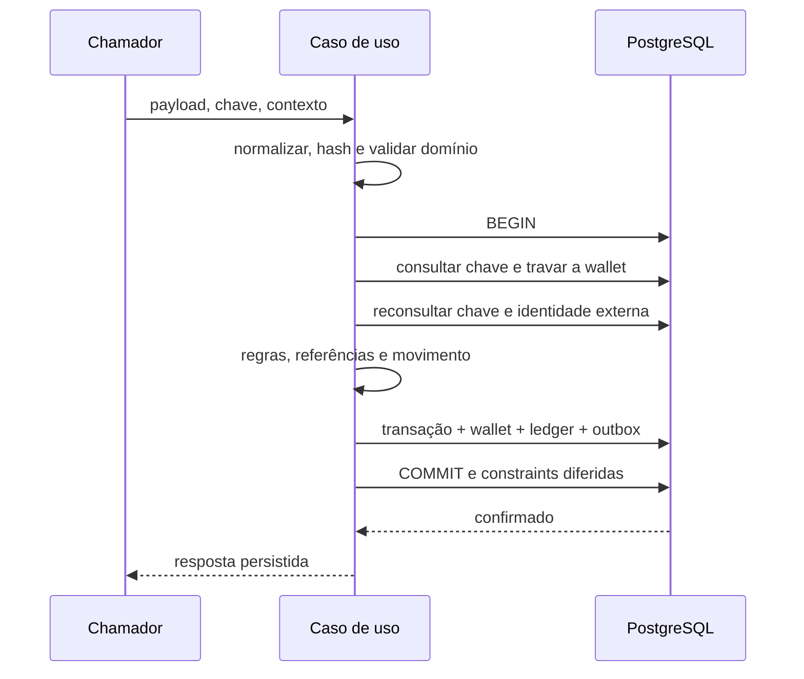

# Criação de wallet e processamento atômico

Implementado e testado em 26/10/2026. Casos de uso conectados ao PostgreSQL por porta transacional, posteriormente integrados a controllers HTTP (ver HTTP_API.md); consumidor SQS, inbox/outbox e scheduler também estão implementados (MESSAGING.md e REFERENCE_SCHEDULER.md). A entrega foi validada em schema financial de projeto Compose isolado; public e o ambiente local do desenvolvedor foram preservados.

## Código e responsabilidades

| Arquivo | Responsabilidade |
|---|---|
| src/application/financial-ports.ts | Contratos da sessão transacional, resultado, relógio/IDs e contexto |
| src/application/financial-use-cases.ts | OpenWallet, ProcessWagerTransaction.execute e resume |
| src/infrastructure/persistence/mikro-financial-unit-of-work.ts | Transação MikroORM, locks, persistência e retry limitado |
| src/infrastructure/persistence/financial-mappers.ts | Conversão de WagerTransaction/ledger para records e reidratação |
| src/infrastructure/persistence/financial-services.ts | Composição com relógio real e UUIDs |
| tests/integration/financial-use-cases.test.ts | Testes PostgreSQL dos casos de uso e concorrência |
| tests/support/process-wager-child.ts | Processo Bun independente usado nas provas de concorrência |

Aplicação depende de FinancialUnitOfWork/FinancialSession; domínio continua sem ORM/NestJS. O adaptador cria um EntityManager por tentativa, com READ COMMITTED, lock pessimista e timeout de lock de 5s. A resposta só é entregue depois do commit efetivo, inclusive dos triggers diferidos.

## OpenWallet

1. Validar player UUID e saldo BRL não negativo.
2. Em transação, verificar duplicidade de player/moeda e criar wallet com versão 1.
3. Se saldo for positivo, criar transação interna OPENING já processada, crédito no ledger e dois eventos na outbox: WagerTransactionProcessed e WalletBalanceChanged.
4. Se saldo for zero, não criar transação financeira, lançamento ou evento de mudança de saldo.
5. Commit ou rollback de todo o conjunto.

A unicidade SQL resolve corridas entre criadores. Se ocorrer 23505, a unidade transacional recomeça com sessão nova e a verificação devolve WALLET_ALREADY_EXISTS. Isso evita tentar consultar em transação PostgreSQL abortada. Abertura não tem contrato público de replay: duplicata é conflito, conforme enunciado.

OPENING usa provider reservado `__internal_opening__`, chave interna derivada da wallet e hash interno de seus campos fixos. Processamento público rejeita providers no namespace `__internal*`, impedindo usá-los para se passar por abertura. Esse isolamento não substitui autenticação/registro futuro de provedores.

## ProcessWagerTransaction.execute



Uma chave terminal conhecida pode ser respondida sem travar wallet, pois o registro é imutável. Para novas operações/pendências, adquirir wallet e reconsultar identidades depois da espera, evitando leituras antigas. Não existe lock global. Referência é consultada por provider/external; estado terminal da referência é imutável.

BET debita; WIN credita; LOSS processa sem movimentar; REFUND/ROLLBACK validam referência e reversão integral. Saldo/player/moeda/referência incompatíveis levam a REJECTED com failureCode e evento, sem ledger. Reversões duplicadas do mesmo tipo são rejeitadas antes do movimento; a unicidade SQL permanece como defesa contra races.

Wallet inexistente ou contrato inválido não são aceitos no ledger: devolvem erro ao chamador sem reservar chave ou criar transação com FK inválida. Mapeamento HTTP virá na próxima etapa. UUIDs inválidos também são barrados antes do banco.

## Replay persistente

Quando terminaliza, o caso de uso grava result_snapshot:

```json
{"transactionId":"UUID","status":"PROCESSED","balance":{"amount":"75.00","currency":"BRL"},"idempotentReplay":false}
```

REJECTED inclui failureCode. Replay usa uma cópia desse JSON, alterando somente idempotentReplay para true. Não consulta saldo atual para reconstruir o resultado. Assim, BET que deixou saldo 75.00 continua retornando 75.00 depois de um WIN posterior deixar saldo 100.00, inclusive em outro processo.

Mesma chave e hash divergente: IDEMPOTENCY_CONFLICT. Mesma identidade provider/external com outra chave: EXTERNAL_TRANSACTION_CONFLICT. As duas garantias são independentes e possuem UNIQUE. Se a corrida envolver wallets diferentes, a perda na constraint provoca rollback completo; a tentativa seguinte encontra o registro vencedor e devolve conflito/replay corretamente.

Resultado devolvido pode ser alterado pelo chamador sem afetar o snapshot no banco. Não existe cache local de idempotência. A imutabilidade dos registros terminais também protege o resultado original.

## Pendência e retomada

Referência ausente ou ainda pendente leva a PENDING_REFERENCE, sem ledger. Persistir próxima tentativa e evento de entrada nesse estado na mesma transação. A resposta pendente não é um snapshot terminal: em replay reflete status persistido e saldo atualmente observado sob lock.

`resume(transactionId)` é uma entrada explícita de recuperação para o scheduler implementado. Ela reidrata a transação existente, trava/revalida a wallet e pode processar ou rejeitar sem criar nova identidade. Repetir uma pendência não repete o evento PendingReference. Tentativas e nextReferenceAttemptAt são persistidos com backoff 1s × 2^tentativas, teto 5min; referência ainda ausente/pendente após 24h vira REFERENCE_EXPIRED terminal, com evento.

**Atualizado:** polling/agendador/claim concorrente foram implementados em REFERENCE_SCHEDULER.md. Resume pode ser chamado manualmente por teste/serviço, sem exigir que nextReferenceAttemptAt já venceu; o scheduler agora seleciona vencidas e usa jitter/claims recuperáveis. Repetir execute de uma pendência não aciona processamento automaticamente.

## Falhas, retries e limite monetário

A unidade transacional admite até quatro tentativas no total para SQLSTATE 23505, 40001, 40P01 e 55P03, sempre após rollback completo, com pequeno backoff/jitter. O callback deve fazer apenas trabalho de banco/domínio: nenhum envio ao broker ou ack dentro dele. Erros desconhecidos ou esgotamento propagam ao chamador; não inventar REJECTED/FAILED confirmado quando o banco falhou.

Saldo acima da capacidade exata gera BALANCE_LIMIT_EXCEEDED, persistido como rejeição com saldo original e sem ledger. A nova Migration202610260002BalanceLimit estende a taxonomia do schema, preservando a migration inicial. Down funciona em schema sem registros do novo código e é recusado atomicamente quando invalidaria auditoria existente. Não apagar/reclassificar auditoria para forçar down.

Updates ORM alteram somente campos mutáveis, preservando identidade e timestamps originais. Isso também evita reescrever precisão submilissegundo do PostgreSQL ao passar por Date JavaScript.

## O que foi provado

- Abertura positiva/zero, conflito concorrente de wallet e rollback antes do commit.
- Saldo histórico no replay, conflito de hash e de identidade externa.
- Rejeições auditáveis, LOSS sem ledger/versão e limite de saldo.
- Falha após escritas financeiras reverte wallet/transação/ledger/outbox; retry aplica uma vez.
- Mesma operação enviada 50 vezes em paralelo: um débito e um par de eventos.
- Duas BETs de 80.00 sobre saldo 100.00: uma processada, outra rejeitada e saldo 20.00.
- Três processos Bun independentes com barreira READY antes de receber comandos: dedup, disputa de saldo e replay histórico após operações posteriores.
- Wallet B avança enquanto uma transação mantém lock da wallet A.
- REFUND antecipado, retomada, TTL, duplicidade de reversão e rollback sem saldo com código distinto.
- Saldo reconstruído pelo ledger conferido nos cenários de wallet.

Registro histórico desta etapa: 149 testes, zero falhas, 509 assertions; typecheck/build aprovados. São 105 unitários e 44 integração, incluindo 24 casos novos deste arquivo. Recursos de teste removidos e processos filhos encerrados.

## Executar no Bash

```bash
# Na raiz do repositório, com Bun 1.4.4 no PATH
docker compose ps
bun test ./tests/integration/financial-use-cases.test.ts
bun test ./tests/unit ./tests/integration
bun run typecheck
bun run build
```

O arquivo de integração já inicia/encerra os três processos filhos necessários; não executar o helper filho manualmente sem o protocolo stdin/schema exclusivo. Não aplicar migrations ao public para executar esses testes.

## Próximas integrações

Controllers, consultas, paginação e reconciliação já implementados em HTTP_API.md. Provisionamento restrito e entrega Compose estão implementados e validados em projeto isolado (DELIVERY.md). Consumidor SQS/inbox integram a mesma FinancialSession; publisher usa lease e scheduler retoma pendências. Envolver execute em outra transação independente não seria atômico.

Consumidor, inbox e publicação SQS já implementados em MESSAGING.md. As provas multiprocesso exercitam os casos de uso PostgreSQL diretamente; não comprovam queda após commit/antes de ack, SIGTERM do consumidor nem publishers concorrentes. Crash/ack e publishers concorrentes foram posteriormente comprovados na suíte de mensageria; SIGTERM no entrypoint também foi comprovado com runtime temporário; rollout persistente permanece para a entrega.
