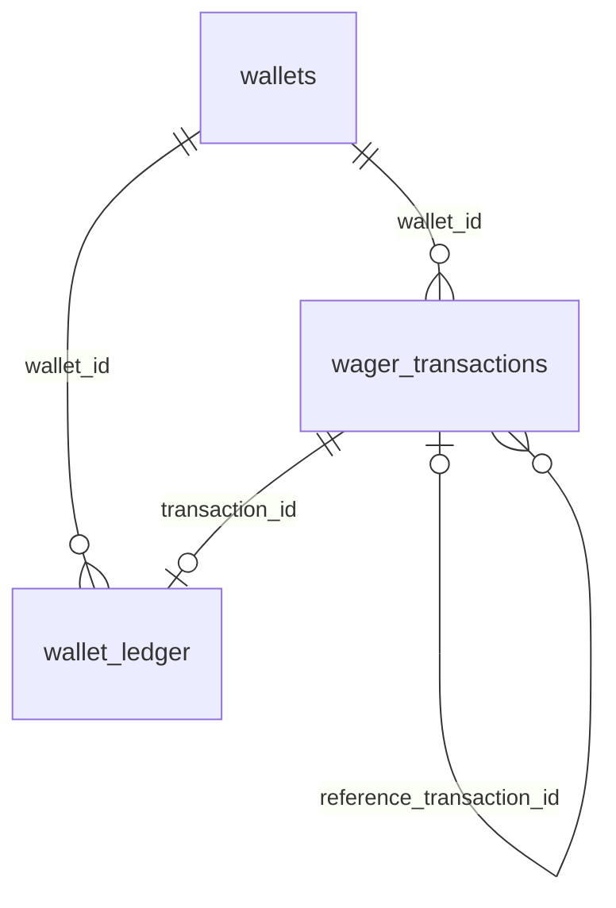

# Mapeamento monetário e schema financeiro

Implementação inicial validada em 26/10/2026. Up/down/up foram exercitados em schemas exclusivos de teste. As três migrations também foram aplicadas ao schema financial do projeto Compose isolado da entrega, sem alterar public ou o banco de desenvolvimento original. Casos de uso financeiros agora existem e são exercitados diretamente nos testes; controllers HTTP implementados e validados em schema isolado (HTTP_API.md).

## Representação exata e ausência de arredondamento

Money.from recebe entradas não negativas; Money.rehydrate recebe representação persistida com sinal opcional e exatamente duas casas. A reidratação não aplica débito/crédito ou transições. Rejeita números JavaScript, formatos inválidos, -0.00 e magnitude acima de 999999999999999999.99.

MoneyMapper separa amount/currency e reconstrói Money. ExactAmountType mantém strings em JS e no driver. Na leitura, texto PostgreSQL como `25` ou `25.0` é normalizado para `25.00`; na escrita ORM, exige representação já canônica. Nunca converte um number devolvido pelo driver para string, porque a precisão já poderia ter sido perdida. WalletMapper converte estado completo sem reaplicar abertura.

**Ajuste da proposta inicial:** as colunas usam `numeric` sem typmod, com CHECK de escala <= 2 e limites equivalentes à capacidade originalmente planejada de numeric(20,2). numeric(20,2) arredonda escala excedente antes da validação; o desenho atual rejeita 0.001 e até 0.000, sem truncar ou arredondar. Referência: [PostgreSQL 17 — Numeric Types](https://www.postgresql.org/docs/17/datatype-numeric.html). NaN e infinitos também são rejeitados pelos limites. Banco pode armazenar escala 0/1; mapper e contratos sempre serializam duas casas.

## Mapa de tabelas



Inbox e outbox são tabelas de transporte; não têm FK obrigatória para a transação de aposta. Sua participação no mesmo commit será coordenada pelo caso de uso.

| Tabela | Garantias principais |
|---|---|
| wallets | UUID, uma wallet/player/moeda, saldo finito não negativo, versão inicial 1 e identidade imutável |
| wager_transactions | chave idempotente global, provider/external únicos, hash, kind/status, referências, failureCode e snapshot terminal |
| wallet_ledger | um lançamento por transação/wallet e por versão; FKs de wallet/moeda/transação, aritmética local, saldos não negativos e append-only |
| inbox_messages | chave composta consumerName/messageId, hash e identidade imutáveis; processedAt não pode voltar após preenchido |
| outbox_messages | ID e envelope coerentes, evento imutável; tentativas, agendamento, publicação e lease atualizáveis |

EntitySchema mantém metadados ORM separados do domínio. Relações financeiras são FKs explícitas na migration; os records usam IDs escalares. Não executar schema sync para substituir DDL: triggers, constraints e índices parciais escritos manualmente são parte da solução.

## Constraints imediatas

CHECKs/FKs/UNIQUE rejeitam valores inválidos, duplicidade de wallet e identidades, moeda divergente no ledger, aritmética inconsistente e mais de um lançamento para a mesma operação. Índice parcial impede duas reversões PROCESSED do mesmo tipo/referência; pendências/rejeições não consomem o direito de reversão. Um REFUND e um ROLLBACK da mesma BET continuam permitidos pela interpretação documentada.

Terminais exigem result_snapshot JSON objeto, com processedAt somente para PROCESSED e failureCode para REJECTED/FAILED. Depois de terminal, dados da transação não podem ser alterados; sua identidade também não pode mudar enquanto pendente. O caso de uso já persiste a resposta terminal e o saldo histórico; o CHECK estrutural de JSON sozinho não valida a semântica pública do snapshot.

## Validações adiadas até o commit

Constraint triggers em wallet/transação/ledger reconsultam o estado final e verificam:

1. Saldo materializado igual à soma dos créditos menos débitos.
2. Versão igual a 1 mais quantidade de movimentos posteriores à abertura.
3. Exatamente um lançamento para cada operação PROCESSED com efeito financeiro; nenhum para LOSS ou não processadas.
4. Valor, moeda, wallet, player e direção coerentes com a transação.
5. OPENING na versão 1; demais movimentos contíguos a partir de 2. Wallet sem abertura positiva começa em zero/versão 1, com primeiro movimento na versão 2.
6. Cadeia balanceBefore/balanceAfter reconstruída por wallet_version. Apenas conferir o total não bastaria para detectar saldos intermediários falsificados.
7. Referência PROCESSED do mesmo provider/player/wallet/moeda/rodada, com tipo permitido e valor integral em reversões. WIN pode ter payout diferente da BET referenciada.

Isso permite escrever wallet, transação e ledger em ordens compatíveis na mesma transação, mas impede confirmar estado parcial. Detalhes das constraints adiadas: [PostgreSQL — CREATE TRIGGER](https://www.postgresql.org/docs/17/sql-createtrigger.html).

## Concorrência, custo e ordem de locks

Triggers de INSERT/UPDATE em transação/ledger adquirem lock da wallet; o verificador final também trava a wallet. Não há lock global. O caso de uso implementado adquire a wallet antes de escrever/reservar a transação, mantendo essa ordem em HTTP e workers. Esta decisão substitui a sequência inicial que sugeria reservar identidade antes do lock.

O verificador faz agregação e janela sobre o histórico da wallet a cada disparo; prioriza correção e transparência, com custo crescente por wallet. Ainda não há benchmark ou prova de latência/throughput. Antes de otimizar, medir; qualquer substituição deve manter garantias verificáveis. Deadlocks ainda podem ocorrer em SQL fora da ordem recomendada: PostgreSQL aborta uma transação e o serviço implementa retry limitado. Os testes SQL desta etapa isoladamente não demonstram concorrência; as provas multiprocesso posteriores estão em FINANCIAL_PROCESSING.md.

## Imutabilidade e permissões

Triggers bloqueiam UPDATE/DELETE no ledger e TRUNCATE nas tabelas auditáveis. Transações terminais e identidade de inbox/outbox têm proteção adicional. REVOKE de permissões públicas e função runtimeGrantSql preparam grants mínimos para um papel **existente, não proprietário**: SELECT/INSERT no ledger e SELECT/INSERT/UPDATE nas outras tabelas, sem DELETE/TRUNCATE/DDL.

A migration não cria usuários ou papéis globais. Testes criam um papel NOLOGIN com nome único, verificam operação financeira válida e negações de privilégios, revogam grants e removem o papel. O PostgreSQL Compose tem conta administrativa para provisionamento; o overlay da aplicação fornece credencial restrita separada para API/workers, validada em projeto isolado (DELIVERY.md). Um proprietário/superusuário pode desativar mecanismos; a proteção pressupõe papel restrito em execução.

## Migração e reversão

Arquivo: `src/infrastructure/persistence/migrations/Migration202610260001FinancialSchema.ts`. O schema é public por padrão, ou o schema explicitamente configurado nos testes. Nomes são validados antes de interpolar identificadores. Down remove as cinco tabelas e funções sem CASCADE. **Down destrói dados financeiros se aplicado a um banco preenchido**; serve para reversibilidade controlada, não reparação rotineira.

Nenhuma migration foi aplicada ao schema público nesta etapa. Para validar, usar o teste isolado abaixo em vez de migration:up/down no desenvolvimento. Aplicação futura ao banco alvo exige conferir configuração e preservar dados existentes. A migration de teste genérica anterior continua cobrindo o mecanismo; o teste novo cobre DDL financeiro real.

## Executar pelo Bash

```bash
cd /home/harlem/projetos/backend-challenge
export PATH="$HOME/.bun/bin:$PATH"
bun test tests/unit/money-mapper.test.ts
docker compose ps
bun test tests/integration/financial-schema.test.ts
bun test tests/unit tests/integration
bun run typecheck
bun run build
```

A suíte SQL cria schema `bb_test_<uuid>` e, para permissões, papel `bb_role_<uuid>`. Exige conta de teste com CREATE SCHEMA/CREATEROLE (a conta local do Compose possui esses privilégios). Remove somente esses recursos no finally/afterAll. Não remover volume, resetar cursor, limpar filas de aplicação ou aplicar down manualmente para repetir testes.

## Evidências e limites

Registro histórico desta etapa: 125 testes passaram, zero falhas, 398 assertions; typecheck e build aprovados. São 105 unitários e 20 de integração (17 SQL financeiros e três de infraestrutura). Incluem escrita/leitura exata pelo ORM no limite, up/down/up, constraints adversariais, rollback incluindo inbox/outbox e permissões restritas.

Após esta etapa inicial, foram implementados porta/repositórios transacionais, preenchimento de result_snapshot e testes com três processos. Ver FINANCIAL_PROCESSING.md. Controllers/replay HTTP, workers, publicação e scheduler estão implementados; ver HTTP_API.md, MESSAGING.md e REFERENCE_SCHEDULER.md. Tabelas inbox/outbox e rollback SQL não equivalem à implementação de seus serviços. FK de wallet exige wallet existente; o contrato trata wallet inexistente antes da aceitação, sem inventar uma wallet para auditar o erro. Rejeições de moeda/player para wallet existente podem preservar os dados solicitados, sem gerar ledger.


## Evolução: migration de limite monetário

Migration202610260002BalanceLimit estende a taxonomia com BALANCE_LIMIT_EXCEEDED para os casos de uso. Up/down/up validado sem dados do novo código; down é recusado atomicamente quando existem registros que ficariam inválidos. A migration inicial permanece preservada. Novas instalações devem aplicar ambas. [Casos de uso e replay](FINANCIAL_PROCESSING.md).


## Evolução: jobs de referência

Migration202610260003ReferenceJobs adiciona coordenação separada, sem alterar o ledger. Novas instalações/runtime atuais exigem três migrations e grants da tabela de jobs. DB_SCHEMA é validado e default public. Scheduler, testes de recuperação e operação restrita estão em [REFERENCE_SCHEDULER.md](REFERENCE_SCHEDULER.md).
